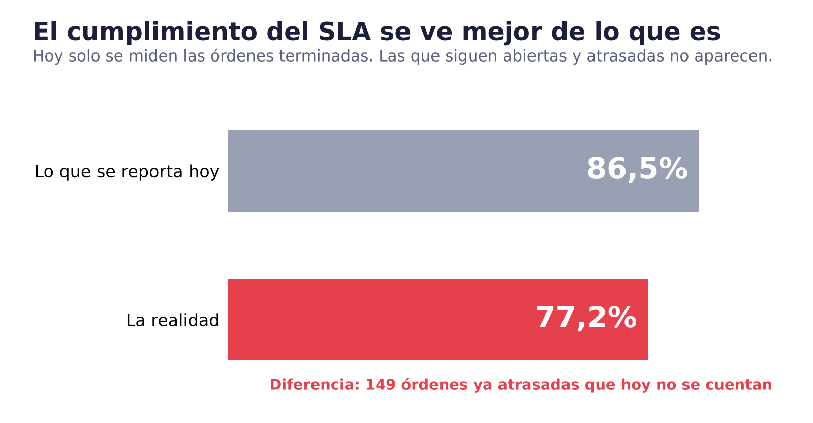
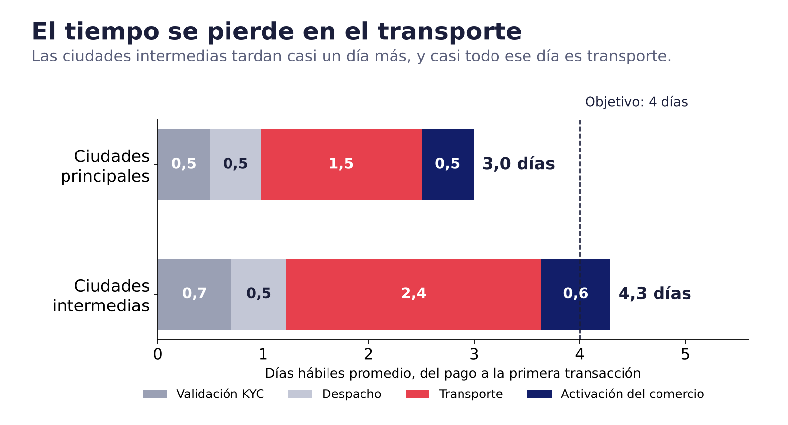
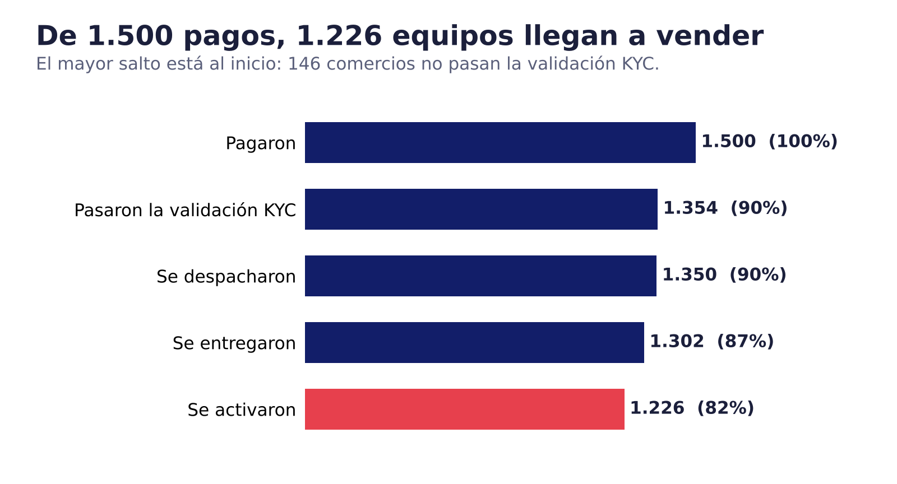
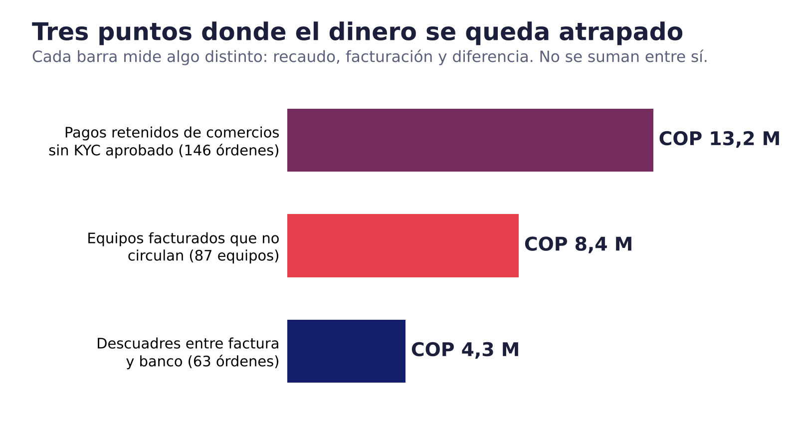
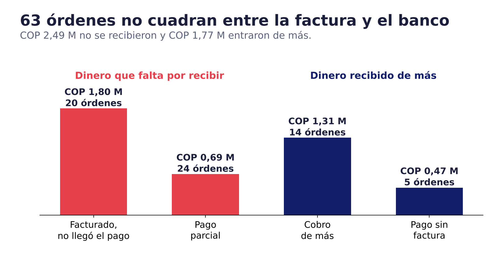

# SalesOps Control Tower

### Del pago a la primera transacción del datáfono: dónde se atasca y cuánto cuesta

> **Proyecto independiente con datos simulados.** Está inspirado en el rol de SalesOps Analyst. No usa datos reales de ninguna empresa, no es experiencia laboral y no está afiliado a Bold.

---

## La historia en 30 segundos

Un comercio paga por un datáfono. Antes de poder vender con él, el pedido pasa por cinco pasos: **pago, validación de identidad (KYC), despacho, transporte y primera venta.** Si un paso se atasca, el comercio no vende y la empresa no gana.

Este proyecto sigue **1.500 órdenes simuladas** por ese camino y responde tres preguntas:

1. ¿Dónde se pierde el tiempo?
2. ¿Qué equipos están perdidos o sin usar?
3. ¿Cuánto dinero no cuadra entre lo facturado y lo que llegó al banco?

| COP 26,2 M | 77,2% | 87 equipos |
|:---:|:---:|:---:|
| facturación en órdenes con algún problema abierto (18,2% del total) | cumplimiento real del plazo de activación (el reporte actual dice 86,5%) | facturados, entregados o en camino, pero sin vender |

---

# Hallazgo 1: el indicador oficial se ve mejor de lo que es

**Qué significa:** el indicador solo cuenta las órdenes que ya terminaron. Un equipo que nunca se activa jamás "termina", así que nunca aparece. Al sumar las **149 órdenes que siguen abiertas y ya van tarde**, el cumplimiento baja de 86,5% a 77,2%.

---

# Hallazgo 2: el tiempo se pierde en el transporte

**Qué significa:** el objetivo es activar en 4 días hábiles. Las ciudades principales lo cumplen (3,0 días). Las intermedias no (4,3 días), y la diferencia está casi toda en el transporte. Entre las transportadoras no hay diferencias relevantes; lo que cambia es la ciudad.

Cumplimiento del plazo, contando también las órdenes abiertas atrasadas: **86,0% en ciudades principales y 56,7% en intermedias.**

---

# Hallazgo 3: el camino de la orden

**Qué significa:** 146 comercios pagaron pero no pasaron la validación. La razón más común de rechazo (44%) es un **documento ilegible**, algo que se puede evitar desde el momento de la carga.

---

# Hallazgo 4: el dinero se queda atrapado en tres lugares

**Qué significa:** cada barra mide algo distinto, por eso no se suman. Los **87 equipos sin circular** se dividen en 65 entregados hace más de 15 días sin activar y 22 en tránsito sin novedad de la transportadora hace más de 5 días.

**Qué significa:** de 1.489 órdenes ya liquidadas, el 95,8% cuadra exacto. Las otras 63 son pagos que no llegaron, pagos parciales, cobros duplicados y pagos sin factura. Los cobros de más son una obligación: hay que devolverlos.

---

# Qué haría yo

1. **Cambiar la métrica:** que el SLA incluya las órdenes abiertas atrasadas y se publique a diario.
2. **Alertas automáticas:** aviso a los 5 días sin novedad del transporte y llamada de activación a los 15 días de entregado el equipo.
3. **Corregir el KYC en el origen:** validar que el documento sea legible apenas se carga, y resolver los pendientes en 3 días hábiles.
4. **Devolver primero:** reembolsar los cobros duplicados y conciliar a diario.
5. **Piloto en ciudades intermedias:** acordar tiempos de transporte objetivo por ruta.

---

# El tablero

Cada excepción se puede filtrar, ordenar, copiar como ticket listo para enviar al área responsable, y marcar como gestionada.

---

# Cómo está hecho

*Esta parte es para quien quiera ver el detalle técnico.*

| Archivo | Para qué sirve |
|---|---|
| `salesops_control_tower.ipynb` | Genera los datos, audita con SQL, valida los resultados, calcula los indicadores y crea el reporte |
| `01_sla_and_reconciliation.sql` | Las dos consultas SQL principales |

Tres decisiones que vale la pena conocer:

* **Los problemas se plantan con cantidades exactas** (65 equipos sin activar, 22 detenidos, 63 descuadres) y el notebook comprueba que el análisis encuentra exactamente esos números. Si no coinciden, se detiene.
* **Los días hábiles se cuentan con una tabla calendario**, porque SQLite no tiene esa función.
* **Los tickets salen de plantillas**, no de inteligencia artificial. El código deja un punto de conexión para enchufar un modelo de lenguaje, pero esa parte no se ejecuta aquí.

---

# Qué no es

* Los datos son inventados. Los porcentajes sirven para mostrar el método, no para describir una empresa real.
* Una orden por comercio, solo se excluyen fines de semana (sin festivos colombianos), sin IVA ni comisiones.
* El supuesto de que el pago se cobra al comprar y no se devuelve si el KYC falla es del modelo.
* Nombres y precios de equipos son de referencia.
* Las consultas usan funciones de SQLite; en BigQuery o PostgreSQL habría que cambiar las de fechas.

---

# Cómo ejecutarlo

Abre `salesops_control_tower.ipynb` en Google Colab y ejecuta todas las celdas. Los parámetros están al inicio y todo se recalcula.
